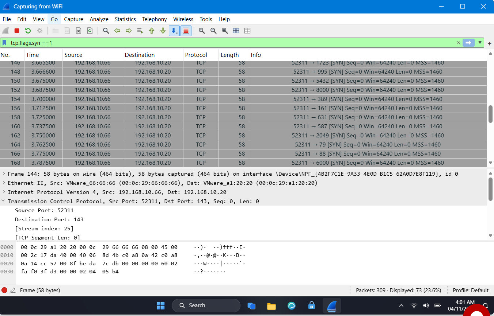
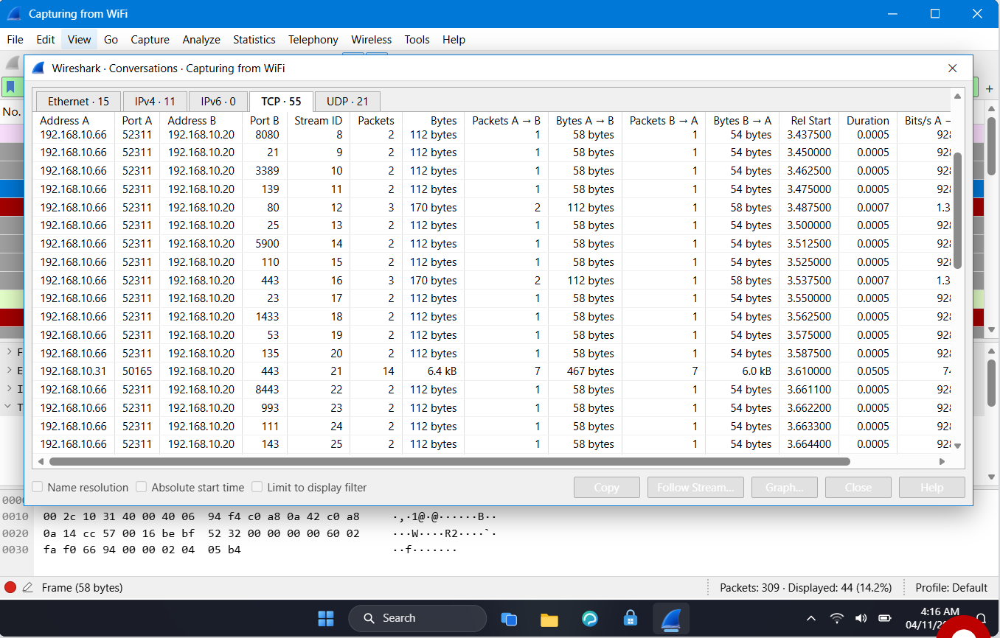
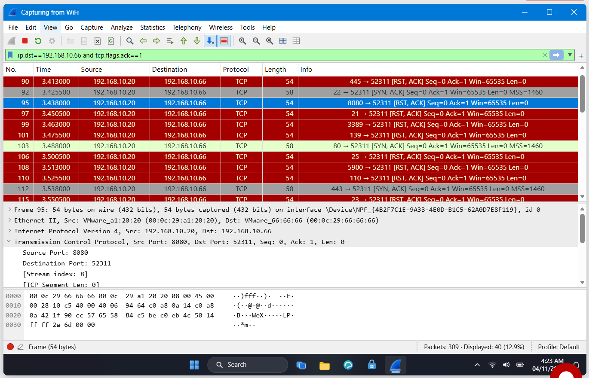

# Lab 1: Identify the Attacker IP

## 📌 Internship Context
This lab was completed as part of my **Cybersecurity Internship at NETWORKWALKS**. It demonstrates my practical ability to use Wireshark to analyze network traffic, identify malicious activity, and determine an attacker's methodology. The objective was to investigate a report of unusual traffic targeting a company's web server.

## 🎯 Objective
- Analyze a packet capture (PCAP) to identify a potential network attack.
- Determine the attacker's IP address and the target's IP address.
- Identify the specific type of attack based on packet behavior.
- Differentiate between open and closed ports based on server responses.

## 🛠️ Tools & Technologies
- **Network Protocol Analyzer:** Wireshark
- **Protocols Analyzed:** TCP, IP
- **Key Concepts:** TCP 3-Way Handshake, SYN Flood vs. Port Scan, TCP Flags (SYN, ACK, RST)

## 🔬 Practical Procedure & Analysis

### 1. Initial Assessment
The capture contained 309 packets. To isolate connection attempts, I applied a filter to view only TCP packets with the SYN flag set.
- **Wireshark Filter:** `tcp.flags.syn == 1`

### 2. Identifying the Attacker and Target
Upon applying the filter, a distinct pattern emerged. A single source IP began sending a rapid succession of SYN packets to a specific destination.
- **Attacker IP:** `192.168.10.66`
- **Target IP:** `192.168.10.20` (The Web Server)
- **Source Port Behavior:** The attacker utilized a static source port (`52311`) while cycling through numerous destination ports.

*Figure 1: Wireshark display showing the rapid sequence of SYN packets from 192.168.10.66.*

### 3. Analyzing the Scope of the Attack
I used the **Statistics > Conversations** menu and examined the TCP tab.
- **Finding:** The attacker (`192.168.10.66`) initiated conversations with the target (`192.168.10.20`) across **40 different ports**.

*Figure 2: TCP Conversations showing 40 distinct ports targeted by the attacker.*

### 4. Evaluating Server Responses
The final step was to determine which of those 40 ports were actually open on the web server. I filtered the traffic to show the server's responses to the attacker.
- **Wireshark Filter:** `ip.dst==192.168.10.66 and tcp.flags.ack==1` (or alternatively, filtering by the attacker's IP to see bidirectional traffic).

Based on the TCP protocol rules:
- **Open Ports:** Respond with a `[SYN, ACK]` packet.
- **Closed Ports:** Respond with a `[RST, ACK]` packet.

- **Results:**
    - **Open Ports:** 3 ports responded with `[SYN, ACK]` (Ports 22, 80, 443).
    - **Closed Ports:** 37 ports responded with `[RST, ACK]`.

*Figure 3: Server responses indicating closed ports (RST, ACK) in red and open ports (SYN, ACK) in grey/green.*

## 💡 Findings & Conclusion
- **Attack Type Identified:** The behavior of rapidly sending SYN packets to numerous different ports on a single target without completing the handshake or sending data is characteristic of a **Port Scan**. 
- **Summary:** The attacker (`192.168.10.66`) successfully scanned the web server (`192.168.10.20`), testing 40 ports and discovering three open services (SSH on 22, HTTP on 80, and HTTPS on 443).
