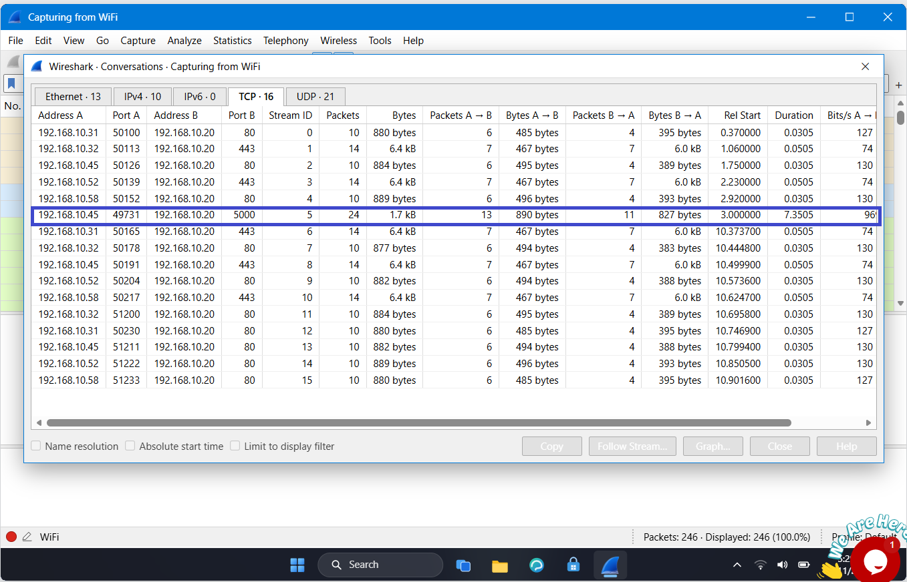
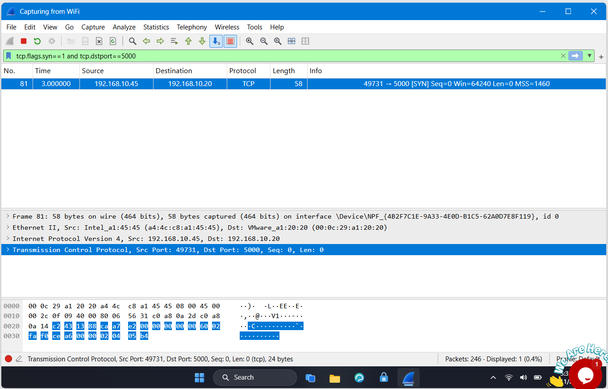
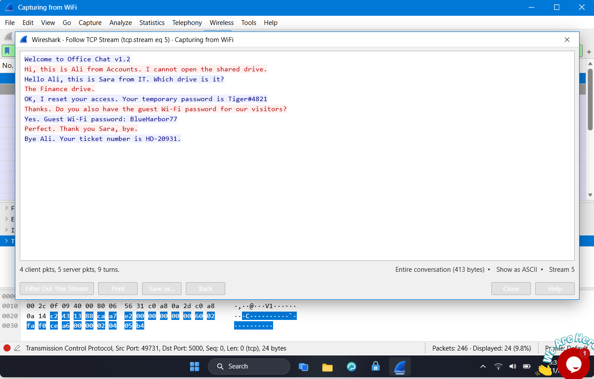

# Lab 2: Follow TCP Stream

## 📌 Internship Context
This lab was completed as part of my **Cybersecurity Internship at NETWORKWALKS**. It focuses on network traffic analysis and data leakage detection. The objective was to investigate an unencrypted legacy office chat tool and demonstrate how plaintext communications can expose sensitive corporate information to packet sniffing.

## 🎯 Objective
- Analyze network conversations to identify non-standard or legacy protocols.
- Locate the specific host initiating the unencrypted communication.
- Reconstruct the TCP stream to extract leaked sensitive data.
- Propose remediation strategies to secure internal communications.

## 🛠️ Tools & Technologies
- **Network Protocol Analyzer:** Wireshark
- **Protocols Analyzed:** TCP
- **Key Concepts:** TCP Streams, Plain Text Protocols, Unencrypted Traffic Analysis, Data Leakage

## 🔬 Practical Procedure & Analysis

### 1. Identifying the Chat Protocol and Port
To find the unencrypted chat tool among standard web traffic (ports 80 and 443), I opened the **Statistics > Conversations** menu and navigated to the TCP tab. 
- **Finding:** I identified an unusual conversation occurring over **Port 5000**.

*Figure 1: Wireshark TCP Conversations statistics showing internal traffic on Port 5000.*

### 2. Locating the Initiating Host
To determine which host started the chat, I filtered the traffic to find the initial SYN packet directed at port 5000.
- **Wireshark Filter:** `tcp.flags.syn==1 and tcp.dstport==5000`
- **Finding:** The first packet (`[SYN]`) was sent by the client host at IP `192.168.10.45` to the server at IP `192.168.10.20`. 

*Figure 2: Filtering for the SYN packet reveals the IP address of the host that initiated the chat.*

### 3. Following the TCP Stream
To read the contents of the chat, I cleared the filters, located a packet containing data on port 5000, and used the **Follow > TCP Stream** feature. This reconstructed the entire conversation.

*Figure 3: The Follow TCP Stream window displaying the unencrypted office chat (red text is from the client, blue text is from the server).*

### 4. Extracting Sensitive Information
By analyzing the reconstructed plain text stream (413 bytes total), I successfully intercepted a conversation between "Ali" (Accounts) and "Sara" (IT). 
- **Leaked Data Identified:**
    - A temporary user password: `Tiger#4821`
    - The Guest Wi-Fi password: `BlueHarbor77`

## 💡 Findings & Conclusion
- **Vulnerability Identified:** The organization is utilizing a legacy chat application on port 5000 that transmits data in plaintext, making it highly vulnerable to packet sniffing and unauthorized data interception by anyone on the local network.
- **Remediation & SOC Recommendation:** The company must immediately decommission the unencrypted chat tool and transition to a secure communication platform that uses standard encrypted protocols (e.g., HTTPS/TLS) to protect internal credentials and sensitive data.
