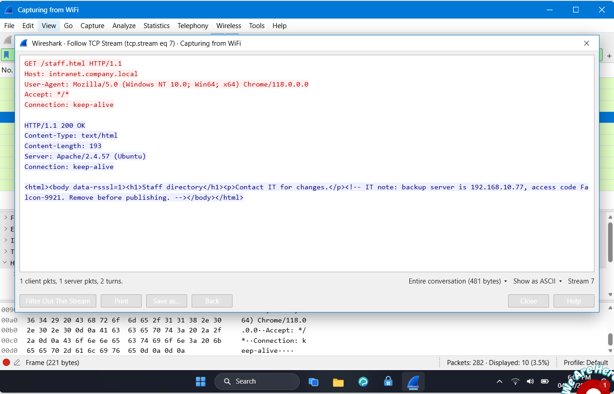
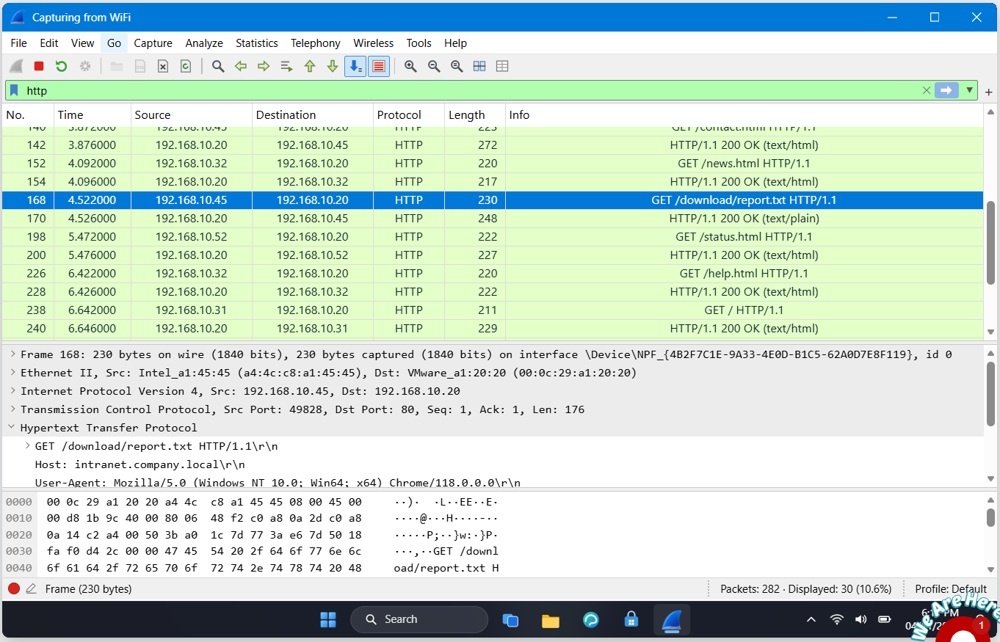
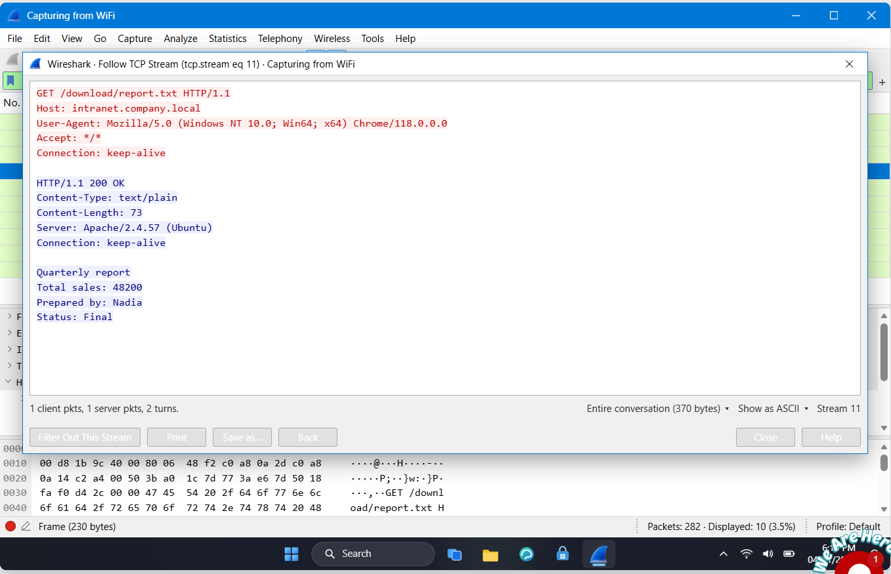

# Lab 3: Follow TCP Stream Part 2 (HTTP & Hidden Data)

## 📌 Internship Context
This lab was completed as part of my **Cybersecurity Internship at NETWORKWALKS**. It focuses on Deep Packet Inspection (DPI) and analyzing unencrypted HTTP web traffic. The objective was to investigate an intranet server to detect hidden notes and track file downloads, demonstrating how sensitive data can be leaked through poor web development practices.

## 🎯 Objective
- Analyze HTTP traffic to inspect web page requests and responses.
- Utilize the "Follow TCP Stream" feature to uncover hidden data within HTML source code.
- Track and reconstruct downloaded files from network packets.
- Identify sensitive information exposed in plaintext.

## 🛠️ Tools & Technologies
- **Network Protocol Analyzer:** Wireshark
- **Protocols Analyzed:** HTTP, TCP
- **Key Concepts:** HTML Comments, TCP Streams, Data Extraction, Information Disclosure

## 🔬 Practical Procedure & Analysis

### 1. Uncovering Hidden HTML Comments
I began by filtering the traffic for HTTP requests to observe the pages accessed by a staff member on the company intranet. By right-clicking the request for `/staff.html` and selecting **Follow > TCP Stream**, I inspected the HTTP response from the server.
- **Finding:** I discovered a hidden HTML comment (`<!-- ... -->`) left by the IT department that was not visible in a standard web browser.
- **Leaked Data:** The comment explicitly exposed the IP address of the backup server (`192.168.10.77`) and a secret access code (`Falcon-9921`).

*Figure 1: TCP revealing sensitive infrastructure details hidden within an HTML comment.*

### 2. Tracking File Downloads
Next, I investigated the traffic to determine if any files were downloaded from the server. I scrolled through the HTTP requests and located a specific `GET` request directed at a download directory.
- **Finding:** A host with IP `192.168.10.45` successfully requested and downloaded a plaintext file named `report.txt` from the `/download/` directory.

*Figure 2: Wireshark packet list showing the HTTP GET request for the file report.txt.*

### 3. Extracting and Analyzing File Contents
To read the contents of the downloaded file, I followed the TCP Stream for the specific HTTP `GET` request associated with `report.txt`.
- **Finding:** The stream successfully reconstructed the text file, revealing internal business data (Quarterly report, Total sales: 48200). 
- **Author Identification:** The document clearly stated that it was "Prepared by: Nadia".

*Figure 3: TCP Stream displaying the reconstructed plaintext contents of the downloaded report.*

## 💡 Findings & Conclusion
- **Vulnerability Identified:** The intranet suffers from severe Information Disclosure vulnerabilities. Developers left sensitive administrative notes in HTML comments, which are easily readable by anyone capturing network traffic or viewing the page source. Additionally, sensitive business reports are being transmitted over unencrypted HTTP.
- **Remediation & SOC Recommendation:** 
  1. Review and remove all internal notes and comments from production HTML code.
  2. Enforce HTTPS/TLS across the entire intranet to encrypt traffic and prevent the interception of downloaded files.
