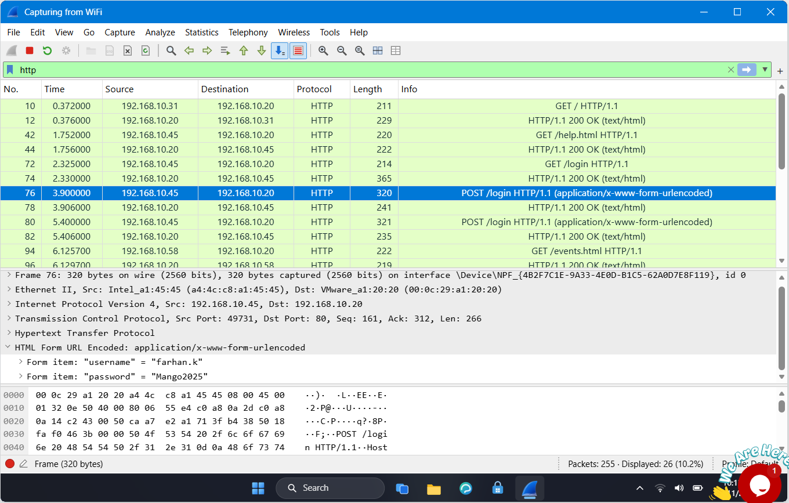
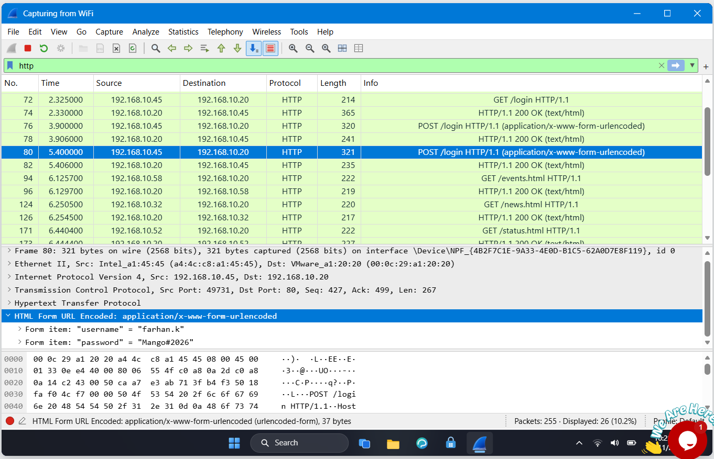

# Lab 4: HTTP Plaintext Credentials

## 📌 Internship Context
This lab was completed as part of my **Cybersecurity Internship at NETWORKWALKS**. It focuses on the security risks associated with legacy web portals. The objective was to analyze unencrypted HTTP traffic to demonstrate how easily an attacker can intercept and read user credentials (usernames and passwords) when they are transmitted in plaintext.

## 🎯 Objective
- Analyze network traffic to identify insecure authentication mechanisms.
- Filter HTTP traffic to isolate login requests.
- Extract plaintext usernames and passwords from HTTP POST requests.
- Observe multiple login attempts to identify incorrect vs. correct credentials.

## 🛠️ Tools & Technologies
- **Network Protocol Analyzer:** Wireshark
- **Protocols Analyzed:** HTTP
- **Key Concepts:** Unencrypted Authentication, Plaintext Credentials, HTTP POST Method, URL Encoding

## 🔬 Practical Procedure & Analysis

### 1. Analyzing the First Login Attempt (Failed)
I began by applying an `http` filter to isolate web traffic directed at the old staff portal. I identified an HTTP `POST` request (Packet 76) directed to the `/login`. By expanding the "HTML Form URL Encoded" section in the packet details, I could read the submitted data.
- **Finding:** The user (`farhan.k`) attempted to log in using the password `Mango2025`.This first attempt failed.

*Figure 1: Wireshark packet details revealing the first login attempt with the username "farhan.k" and the incorrect password "Mango2025".*

### 2. Analyzing the Second Login Attempt (Successful)
Shortly after the first attempt, I observed a second HTTP `POST` request (Packet 80) to the same `/login`. Inspecting this packet's "HTML Form URL Encoded" payload revealed a different password. 
- **Finding:** The user (`farhan.k`) tried again with a new password, `Mango#2026`. This attempt was successful.

*Figure 2: Packet details showing the second, successful login attempt using the correct password "Mango#2026".*

## 💡 Findings & Conclusion
- **Vulnerability Identified:** The legacy staff portal transmits authentication credentials in clear text over HTTP. This is a critical security flaw, allowing any unauthorized individual on the network to intercept and read both failed and successful login attempts. 
- **Remediation & SOC Recommendation:** All web traffic, especially authentication pages, must be encrypted using **HTTPS (TLS/SSL)** to ensure that intercepted payloads remain unreadable to attackers.
