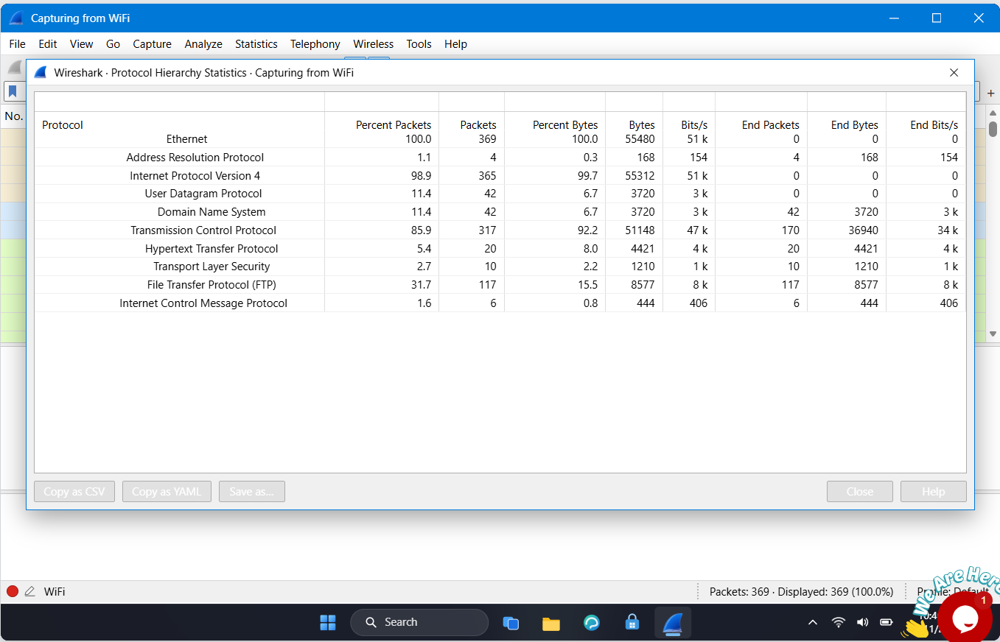
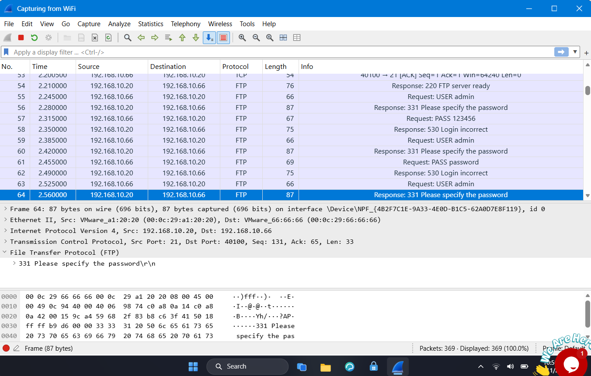
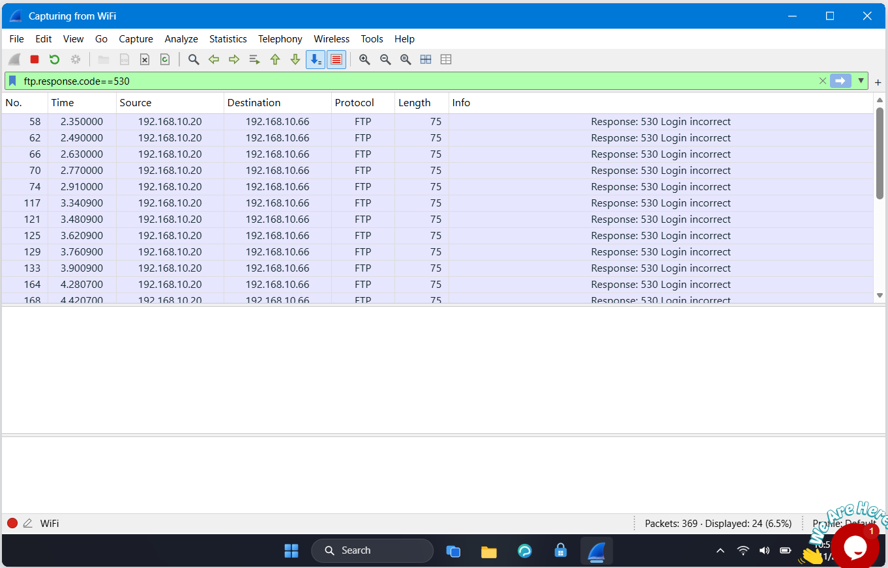
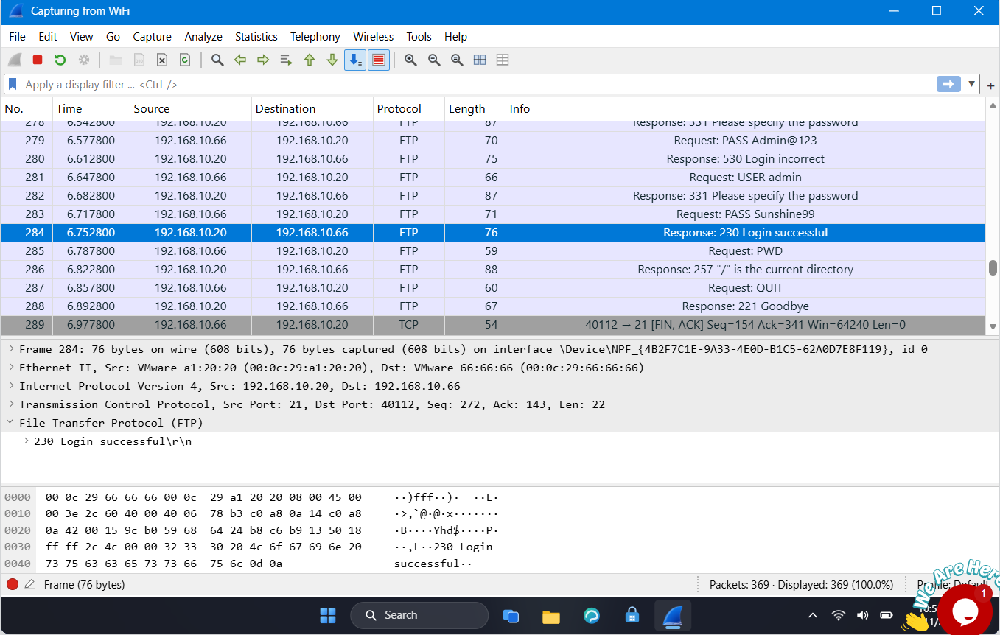

# Lab 5: Brute Force Catch

## 📌 Internship Context
This lab was completed as part of my **Cybersecurity Internship at NETWORKWALKS**. It focuses on detecting and analyzing brute-force attacks against network services. The objective was to investigate numerous failed login attempts on an FTP server, identify the attacker, and determine if the server was compromised.

## 🎯 Objective
- Analyze network traffic to identify the targeted protocol and the attacker's IP address.
- Utilize Wireshark filters to quantify the number of failed login attempts.
- Determine the specific username targeted during the attack.
- Identify the exact password that successfully compromised the server.

## 🛠️ Tools & Technologies
- **Network Protocol Analyzer:** Wireshark
- **Protocols Analyzed:** FTP, TCP
- **Key Concepts:** Brute-Force Attacks, FTP Response Codes, Unencrypted Authentication

## 🔬 Practical Procedure & Analysis

### 1. Identifying the Targeted Protocol
To determine which service was under attack, I opened the **Statistics > Protocol Hierarchy** menu. 
- **Finding:** I observed a significant volume of traffic associated with the **File Transfer Protocol (FTP)**, making it the primary target.

*Figure 1: Wireshark Protocol Hierarchy Statistics indicating high FTP activity.*

### 2. Analyzing the Attack Pattern
By inspecting the FTP traffic in the packet list, I observed a clear pattern of authentication attempts. An attacker from IP `192.168.10.66` was repeatedly sending `USER` and `PASS` commands to the FTP server at `192.168.10.20`.
- **Targeted Account:** The attacker consistently targeted the `admin` username.

*Figure 2: Plaintext FTP traffic revealing the attacker targeting the "admin" account.*

### 3. Quantifying Failed Login Attempts
To determine the extent of the attack, I filtered the traffic for the standard FTP response code indicating a failed login (`530 Login incorrect`).
- **Wireshark Filter:** `ftp.response.code==530`
- **Finding:** The filter displayed **24** instances of failed login attempts from the attacker.

*Figure 3: Filtering for FTP response code 530 reveals 24 failed login attempts.*

### 4. Detecting a Successful Compromise
Finally, I needed to check if the brute-force attack was ultimately successful. I looked for the FTP response code indicating a successful login (`230 Login successful`).
- **Finding:** I discovered a `230` response code (Packet 284). By examining the `PASS` command sent immediately prior (Packet 283), I identified the compromised credentials.
- **Compromised Credentials:** The attacker successfully logged in as `admin` using the password `Sunshine99`.

*Figure 4: Packet list showing the successful login attempt with the password "Sunshine99" resulting in a 230 response code.*

## 💡 Findings & Conclusion
- **Vulnerability Identified:** The use of plaintext FTP exposes credentials. Furthermore, the server lacks protection mechanisms against repeated failed login attempts.
- **Remediation & SOC Recommendation:**
    1. Immediately disable the compromised `admin` account or force a complex password reset.
    2. Migrate from legacy FTP to a secure protocol like SFTP or FTPS to encrypt credentials in transit.
    3. Implement account lockout policies or intrusion prevention systems (IPS) to detect and block brute-force attacks after a set number of failed attempts.
