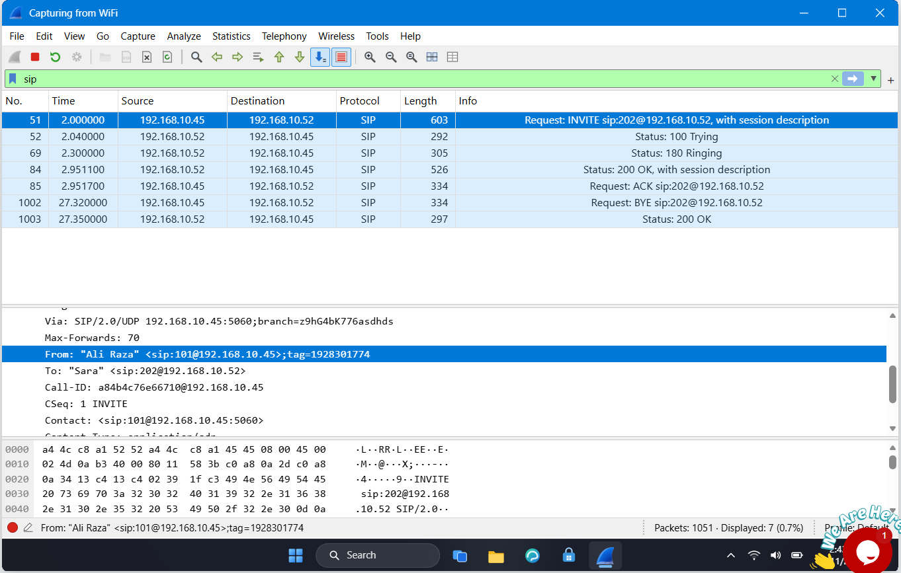
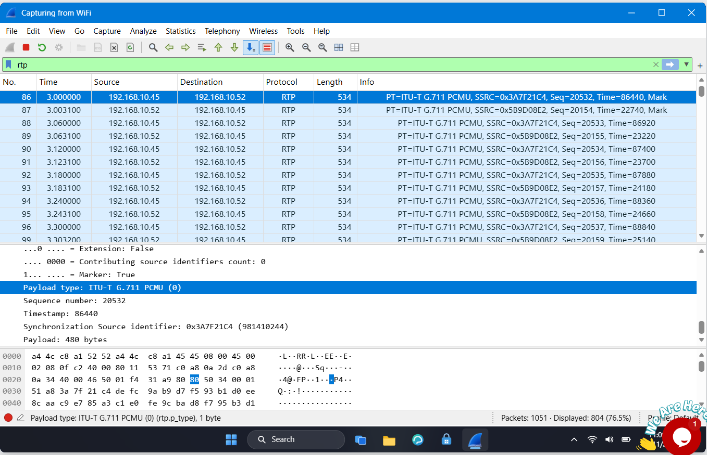
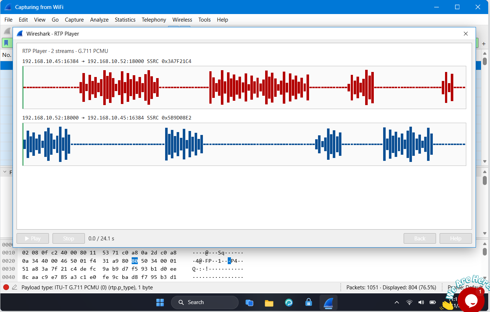

# Lab 6: VoIP Call Replay

## 📌 Internship Context
This final lab was completed as part of my **Cybersecurity Internship at NETWORKWALKS**. It demonstrates the critical security risks of using unencrypted Voice over IP (VoIP) systems. The objective was to analyze network traffic to isolate a VoIP phone call, extract the session signaling details, and successfully replay the captured audio to intercept sensitive information.

## 🎯 Objective
- Analyze network traffic to identify VoIP signaling and media protocols.
- Extract caller identification and extension details from SIP packets.
- Identify the specific audio codec used for the voice transmission.
- Replay the RTP audio stream to intercept sensitive spoken data (credit card details).

## 🛠️ Tools & Technologies
- **Network Protocol Analyzer:** Wireshark
- **Protocols Analyzed:** SIP, RTP
- **Key Concepts:** VoIP Security, Unencrypted Audio Interception, Telephony Analysis

## 🔬 Practical Procedure & Analysis

### 1. Analyzing Call Setup (SIP)
I began by filtering the traffic for the **Session Initiation Protocol (SIP)**, which is responsible for setting up and managing the call. 
- **Wireshark Filter:** `sip`
- **Finding:** By inspecting the initial `INVITE` packet, I identified the caller's extension and name. 
- **Caller Details:** The call was initiated by "Ali Raza" from extension `101`.

*Figure 1: Overview of the SIP signaling process and packet details revealing the caller's name and extension.*

### 2. Identifying the Audio Stream (RTP)
Once the call was established, the actual voice data was transmitted using the **Real-time Transport Protocol (RTP)**.
- **Wireshark Filter:** `rtp`
- **Finding:** By examining the payload of an RTP packet, I identified the audio codec being used.
- **Audio Codec:** The voice traffic was uncompressed using the `ITU-T G.711 PCMU` codec.

*Figure 2: RTP packet details revealing the use of the G.711 PCMU audio codec.*

### 3. Replaying the Intercepted Audio
To extract the sensitive information spoken during the call, I used Wireshark's built-in telephony tools (**Telephony > VoIP Calls > Play Streams**).
- **Finding:** Because the RTP traffic was unencrypted, I was able to listen to the audio conversation between Ali Raza and the receiver (Sara).
- **Leaked Data:** During the intercepted call, the caller verbally provided his credit card details to pay an invoice. 

*Figure 3: Wireshark's RTP Player interface, showing the successfully playable bidirectional audio streams.*

## 💡 Findings & Conclusion
- **Vulnerability Identified:** The company's VoIP system transmits both call signaling (SIP) and voice media (RTP) in clear text over the network. This allows any attacker capable of packet sniffing to easily intercept, record, and replay private corporate phone calls, leading to severe data breaches (e.g., stolen credit card information).
- **Remediation & SOC Recommendation:** The organization must immediately implement encryption for its telephony infrastructure. 
    1. Implement **SRTP (Secure Real-time Transport Protocol)** to encrypt the actual voice data.
    2. Implement **TLS (Transport Layer Security)** for SIP to protect call signaling and caller identities.

